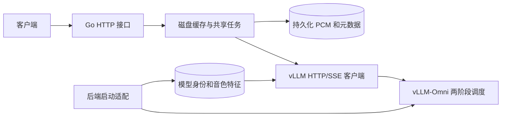

# 工程结构与运行语义

## 模块边界

| 目录 | 职责 | 依赖 |
| --- | --- | --- |
| `cmd/gateway` | 创建依赖、监听端口、信号退出 | config、engine、cache、httpapi |
| `internal/config` | 环境变量和资源限制 | Go 标准库 |
| `internal/engine` | 验证模型身份，向官方 API 请求增量 PCM，验证终止事件 | config |
| `internal/cache` | FIFO 等待队列、固定并发 worker、磁盘记录、读者补读 | config、engine 的请求和元数据类型 |
| `internal/httpapi` | 中文响应、输入校验、查询和流式音频协议 | config、engine、cache |
| `backend` | 模型内容校验、音色预计算、官方配置调整与进程启动 | 官方镜像内依赖 |
| `deploy` | 容器打包和代理配置 | 两端入口 |

cache 通过生成函数接入 engine，不解析上游 SSE。httpapi 不写缓存文件。engine 不处理外部 HTTP 响应。各包测试随源码放置。

## 真正并行与共享生成

`TTS_MAX_CONCURRENT_TASKS=C` 控制 Go worker 数，也设置两个 vLLM 阶段的 `max_num_seqs`。`TTS_MAX_PENDING_TASKS=P` 允许额外 P 个不同任务等待；共最多 C+P 个未完成任务。队列满时返回 503。相同请求加入已有任务，不新增推理槽位。

这些 worker 共用同一套推理引擎和模型权重。vLLM-Omni 决定 GPU 调度和批处理，不会为每路请求创建一份完整模型。提高并发仍会增加 KV cache、解码状态和计算竞争，需要在实际 GPU 上调参。

任务超时从入队开始。单个客户端断开不取消共享任务，其他客户端可继续接收；全部客户端断开后，任务也会继续到完成、超时或失败。进程退出时取消尚未完成的任务。

后端每生成一块 PCM 即经 SSE 交给网关，网关写入磁盘后通知读者。整个流程不等待完整 WAV 生成。

## 磁盘缓存

每个任务对应 `tts-*.pcm`。只有收到上游显式 `speech.audio.done`、音频非空、PCM 写入并同步成功后，才原子生成同名 `.json` 完成标记。网络 EOF、上游错误、超时、输出超限均为失败；失败任务可立即重试，部分音频不作为成功缓存。

Go 只在内存中保存索引、通知状态和有上限的收发块，不保存整段 PCM。每个读者独立从 offset 0 读磁盘，因此晚加入客户端可以完整补读。

缓存 TTL 是滑动过期：从最后访问时间或生成完成时间的较大者开始计算。每次完整缓存命中立即持久化访问时间。重启时仍按当前配置判断，停机时间计入 TTL，没有额外的固定五分钟门控。

`TTS_CACHE_MAX_MB` 是磁盘音频预算，活跃任务先预留最多 8 MB（配置总容量不足 8 MB 时按总容量预留），完成后改为实际大小。容量不足时先淘汰没有读者的完整缓存，按最近访问时间排序。正在写入或被读取的记录不会被驱逐。JSON 元数据和文件系统开销不计入 PCM 容量，磁盘还需少量余量。

TTL 和容量是两个独立条件：未过期的记录可能因为容量不足而提前淘汰；过期记录即使磁盘尚有空间也会清理。重启会清理未提交文件、损坏记录和临时文件。单个 PCM 超过内部 8 MB 上限时生成失败，长播报应拆分文本；这不是推理并发限制。

按单个 gateway 管理一个缓存目录部署，无目录进程锁、分布式锁或多副本网关一致性机制。

## 模型身份与重启

后端启动适配按模型文件内容、参考录音/转写、引擎版本、启动适配源码和生成配置计算身份。自定义音色特征持久化在 backend-state 卷，内容一致且校验通过时复用，避免每次启动重新提取。

后端通过 `--served-model-name tts-<identity>` 公布正在运行的身份；网关将共享元数据与 `/health`、`/v1/models` 核对。请求缓存键包含该身份，排队任务在提交前再次核对。首次启动的网关必须验证引擎，才能使用磁盘旧结果；已验证身份的网关遇到短暂后端故障时可继续提供匹配缓存，拒绝新推理。

参考音色预计算是逐个启动短生命周期进程，完成后释放 GPU 再启动服务。请求只传音色名称。实际推理时所需的参考特征和状态仍占用资源，多音色数量和并发规模都应做远端验收。
